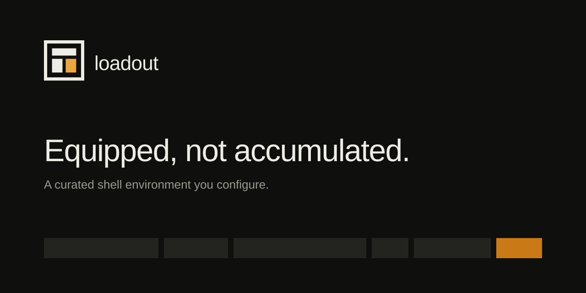

# loadout

A curated shell environment you configure rather than edit.

loadout ships an opinionated set of aliases and shell functions, renders them against your own configuration, and writes a single file your shell sources at startup. The personal parts — who you are in git, where your projects live, which machines you upload to — are configuration, not something you fork and hand-edit.

Linux and macOS. zsh and bash.

## Install

```sh
curl -fsSL https://loadout.makery.tools/install.sh | sh
```

Or with Homebrew:

```sh
brew tap loadoutsh/loadout
brew install loadout
```

Or from source, if you have Go:

```sh
go install github.com/loadoutsh/loadout/cmd/loadout@latest
```

## Getting started

```sh
loadout init      # a few questions; detected values offered as defaults
loadout apply     # render your configuration into a shell file
loadout doctor    # check everything it asks for works on this machine
```

Then add one line to your shell config:

```sh
source ~/.config/loadout/init.zsh
```

loadout never edits your shell config for you. That line is yours to add.

That line brings in the aliases and functions. It does not bring in your
credentials — those need a second line, and
[Credentials](#credentials) explains why and what it costs.

## How it works

```
~/.config/loadout/config.yaml  ──►  loadout apply  ──►  ~/.config/loadout/init.zsh
        ▲                                                        │
        │                                                        ▼
   loadout CLI  ◄──►  loadout ui                        sourced by your shell
```

An alias cannot be a program: `gpush` and `..` are shell state, so loadout generates shell rather than intercepting commands. Nothing runs when you open a terminal — the generated file is static text, regenerated only when you run `apply`.

Two of the shipped functions, `p` and `activate`, change your shell's directory and environment. They stay real shell functions for that reason; a child process cannot `cd` for its parent.

## Commands

| Command             | What it does                                                     |
| ------------------- | ---------------------------------------------------------------- |
| `loadout init`      | Create your configuration                                        |
| `loadout apply`     | Render the shell file                                            |
| `loadout doctor`    | Report anything that would not work here                         |
| `loadout describe`  | What a command does, how to call it, what it needs               |
| `loadout catalog`   | What the shipped set contains                                    |
| `loadout ui`        | Local web interface                                              |
| `loadout bin`       | Manage third-party executables on your PATH                      |
| `loadout cred`      | Secrets, stored in your OS keychain                              |
| `loadout env`       | Print export lines for the active credentials, for `eval`        |
| `loadout identity`  | Switch git author, SSH key and credentials together              |
| `loadout sync`      | Keep your configuration in git across machines                   |
| `loadout scan`      | Check your config for anything that looks like a live credential |
| `loadout uninstall` | Remove everything loadout has put on this machine                |

## Configuration

Everything personal lives in `~/.config/loadout/config.yaml`.

```yaml
paths:
  project_root: ~/Projects
  venv_root: ~/.venv

identities:
  - id: personal
    git_user: Your Name
    email: you@example.com
    ssh_key: ~/.ssh/id_ed25519 # optional; omit it and `s` leaves the agent alone
    default: true

workspaces:
  - name: api
    path: ~/Projects/api/api.code-workspace
    tmux_session: api

hosts:
  - alias: staging
    hostname: staging.example.com
    user: deploy
    key: ~/.ssh/deploy # optional; omit it and ~/.ssh/config chooses

packs: [ansible, cloudflared]
```

Run `loadout describe <command>` to see which sections shape which command.

### Packs

Most of the catalog is on by default. Ecosystem-specific bundles — flutter, jekyll, gatsby, exercism, git-flow, cloudflared, ansible — are packs, off unless you enable them. Toggle them in `loadout ui` or list them under `packs:`.

### Anything you disagree with

```yaml
aliases:
  disabled: [ls, py]
  custom:
    - name: deploy
      command: ./scripts/deploy.sh
      platform: [linux]
```

## Credentials

Secrets live in your OS keychain — Keychain on macOS, libsecret or `pass` on Linux — and never in a file loadout controls. Your configuration records only which entries exist and which is active.

```sh
loadout cred set npm_token work    # prompts, does not echo
loadout cred use npm_token work    # switch the active entry
eval "$(loadout env)"              # bring the active values into this shell only
```

The exported variable name is derived from the credential key — `npm_token`
becomes `NPM_TOKEN`. When the tool reading it expects something else, say so:

```yaml
credentials:
  gh_token:
    env: GHP_TOKEN # what gets exported, when the key does not derive it
    active: personal
    entries: [personal, work]
```

Two credentials resolving to the same variable is rejected at load time, since
otherwise one would silently overwrite the other.

### Why `loadout env` on its own changes nothing

`loadout env` prints export lines. It does not set them. It runs as a child process, and a child cannot change its parent's environment — the same constraint that makes `p` and `activate` shell functions rather than subcommands. Run it bare and you will see your credentials listed, correctly, while `echo $NPM_TOKEN` stays empty. Nothing has read that output yet.

The `eval` is what applies it, to that one shell. For every shell, add a second line to your shell config, below the `source`:

```sh
source ~/.config/loadout/init.zsh
eval "$(loadout env --quiet)"
```

`--quiet` drops the diagnostics, so a locked or unavailable keychain cannot write into every new shell you open.

This is opt-in on purpose, and the cost is real in both directions. Writing secrets into the generated file would leave them in plain text on disk, so something has to fetch them at runtime instead — but that something reads your keychain every time a shell starts, and puts the tokens in the environment of every process you launch from it. Add the line if you want that; leave it out and use `eval "$(loadout env)"` in the shells that need it.

An identity can nominate credential entries, so `s work` switches your git author, your SSH key and your tokens in one command. It changes which entry is active; the shells you already have open keep the values they were given, until you re-run the `eval`.

## The web interface

```sh
loadout ui
```

Starts a small server on `127.0.0.1`, opens your browser, and stops when you
stop the command. There is no daemon and nothing left running afterwards.

It gives you the alias catalog with live availability — every alias shown with
whether the tool it needs is actually installed on this machine — plus pack
toggles, credential switching, the command reference, and a diff of the
generated shell file before anything is written. A flat config file cannot tell you
which of your aliases point at tools you never installed; this can.

### Why it is bound to loopback

This interface rewrites the file your shell sources on every login. That makes
it, in effect, a remote code execution API for your account. Binding to
`127.0.0.1` keeps other machines out, but it does not keep other _pages_ out:
any site open in your browser can issue requests to localhost. Three checks run
before any request is served.

- **A per-run token.** Generated at startup, compared in constant time, and
  gone when the server stops. It reaches the page in the query string, because
  a browser navigation cannot set a header, and the page moves it into
  `sessionStorage` and strips it from the URL so it does not linger in your
  address bar or history.
- **Origin must be ours.** A request carrying any other site's `Origin` is
  refused before the token is even considered.
- **Host must be loopback.** This is the defence against DNS rebinding, where
  an attacker points a hostname they control at `127.0.0.1` so your browser
  treats their page as same-origin. Their hostname will not match.

Static assets are the one exception: `app.css` and `app.js` are served without
a token, because a `<link>` or `<script>` tag cannot present one. They are
inert files compiled into the binary and identical for every user. Everything
that reads your configuration or writes to disk is behind the token.

**Treat the printed URL as a secret** for as long as the server is running.

### On a server with no browser

Use SSH port forwarding. This is the intended answer, and it needs no
configuration.

```sh
# on the server
loadout ui --port 8800 --no-open --print-url

# on your laptop, in another terminal
ssh -L 8800:127.0.0.1:8800 you@server
```

Then open the URL the server printed. Your browser connects to `127.0.0.1` on
your own machine, SSH carries the traffic, and nothing listens on a public
interface. The `Host` header is loopback, so the checks above pass unchanged.

`--no-open` stops it trying to launch a browser that is not there.
`--print-url` prints only the URL, for scripting.

### Why there is no reverse proxy support

Putting the interface behind `https://loadout.example.com` does not work, by
design. A proxy sends `Host: loadout.example.com`, the loopback check refuses
it, and the request gets a 403 before reaching any handler.

Allowing a configured hostname would be a small change. It is deliberately not
offered, because that `Host` check is the DNS rebinding defence, and removing
it leaves a single per-run token in a URL as the only thing between the public
internet and an API that rewrites what your shell executes at every login.
URLs leak: through browser history, referrer headers, proxy logs, screen
shares. A leaked token here is not an information disclosure, it is arbitrary
code execution on that machine the next time you open a terminal. The token is
also valid for the entire life of the process, with no revocation and no audit
trail.

If you genuinely need a remote interface, the authentication has to live in
front of it — mTLS, an OAuth proxy, or at the very least HTTP basic auth over
TLS — and you should treat that as running an admin panel for your shell,
because that is what it is. SSH forwarding gives you the same access, over a
credential you already have, with nothing new exposed.

## Binaries and scripts

Third-party executables are declared, not committed, and fetched per platform into a managed directory that loadout appends to your `PATH`.

```yaml
binaries:
  - name: duckdb
    version: v1.1.3
    source:
      github: duckdb/duckdb
      asset:
        linux-amd64: duckdb_cli-linux-amd64.zip
        darwin-arm64: duckdb_cli-osx-universal.zip
    checksum:
      linux-amd64: sha256:efd0fcc...
```

```sh
loadout bin install   # fetch, verify, install
loadout bin list      # versions, source URLs, whether verified
```

This is the one part that downloads and then runs code, so: HTTPS on every redirect hop, checksums verified before anything is installed, archive members with unsafe paths refused, and the source URL recorded so you can always see where something on your PATH came from.

The managed directory is **appended** to `PATH`, not prepended, so a managed binary cannot shadow a system tool.

## Sync

```sh
loadout sync init git@github.com:you/loadout-config.git
loadout sync push
loadout sync pull
```

Only `config.yaml` travels. The generated file is regenerated per machine, and `local.yaml` exists to hold whatever must not travel — it overlays `config.yaml` and is never synced.

A scanner runs before the commit, not before the push, so a credential pasted into your config never enters the history at all.

Use a private repository. The config holds no secrets, but it names your hosts, paths and identities.

## Updating

```sh
loadout update --check    # is there a newer release?
loadout update            # install it
```

It only replaces the binary when loadout owns the file. If Homebrew or the Go
toolchain installed it, that tool owns it, and overwriting the file behind its
back leaves it reporting a version it never installed — so `update` prints the
right command for your install method instead.

The download is HTTPS on every hop, the checksum is verified, and a release
publishing no checksum is refused outright. The replacement is a rename, so an
interrupted update cannot leave a broken binary on your PATH.

## Uninstalling

```sh
loadout uninstall          # lists everything, removes nothing
loadout uninstall --yes    # do it
```

Deleting the directories by hand leaves every keychain entry behind, and
leaves them unfindable: your config is the only record of what they are
called. `uninstall` lists them by name first, including any the config has
forgotten about, and asks for a separate confirmation before deleting a
secret.

`--keep-config` retains your configuration for a reinstall. `--keep-credentials`
leaves the keychain alone entirely.

Two things it will not do: edit your shell config, since it never wrote that
line in the first place, and delete its own binary. It prints the exact line
and the right command for both.

## Development

```sh
make check     # build, vet, test, format
make golden    # re-record the golden files after an intended change
make release   # cross-compile every platform into dist/ with checksums
make tap       # render the Homebrew formula from those checksums
make notes     # preview the release notes for VERSION
```

The generated shell is pinned by golden files in `testdata/golden`, covering both shells and both platforms. A change to the catalog or a template shows up as a diff there, which is what you review.

### Releasing

Pushing a `v*` tag runs the release workflow: it tests, cross-compiles all four platforms, builds the release notes, publishes a GitHub release with the tarballs and `checksums.txt`, renders the Homebrew formula from those checksums, and commits it to the tap.

Release notes come from the version's section in [CHANGELOG.md](CHANGELOG.md), with install and upgrade instructions and the checksums appended. One part is computed rather than written: the notes diff `testdata/golden` against the previous tag, and when the generated shell changed they say so and tell readers to run `loadout apply`. Upgrading the binary does not rewrite the file a shell sources, so without that line an upgrade looks like it did nothing.

The tap push needs a `TAP_GITHUB_TOKEN` secret with write access to `loadoutsh/homebrew-loadout`. Without one the release still publishes and the workflow warns instead of failing, since a missing tap update should not block the release everyone else installs from. Publish `dist/loadout.rb` by hand in that case: a tap left behind keeps serving the old version, and `brew upgrade` will report there is nothing to do.

## Contributing

Read [CONTRIBUTING.md](CONTRIBUTING.md) first. It covers where a change belongs
— core, pack, user config, or nowhere — and the handful of rules that exist
because something went wrong without them.

- [CHANGELOG.md](CHANGELOG.md) — what changed, per release
- [docs/DESIGN.md](docs/DESIGN.md) — architecture and the decisions behind it
- [docs/ALIAS-TRIAGE.md](docs/ALIAS-TRIAGE.md) — how the shipped set was chosen
- [SECURITY.md](SECURITY.md) — threat model, defences, and how to report
- [CODE_OF_CONDUCT.md](CODE_OF_CONDUCT.md)

## Licence

MIT. See [LICENSE](LICENSE).
